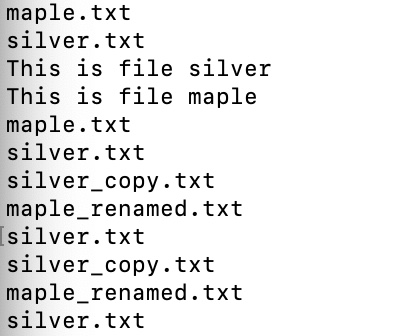
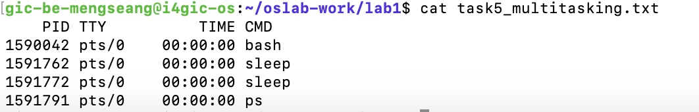

# Operating Systems Lab 1

## Student Information

- Name: Mengseang
- Student ID: e20230455
- Course: Operating Systems
- Date: November 6, 2026

## Lab Tasks

| Task | Description | Submission File |
|---|---|---|
| Task 1 | Operating System Information | task1_os_info.txt |
| Task 2 | File and Directory Commands | task2_file_commands.txt |
| Task 3 | APT Package Management | task3_apt.txt |
| Task 4 | Process Information | task4_process_list.txt |
| Task 5 | Multitasking | task5_multitasking.txt |
| Task 6 | Virtualization Detection | task6_virtualization_check.txt |

## Screenshots

### Task 3

### Task 5

### Task 6

